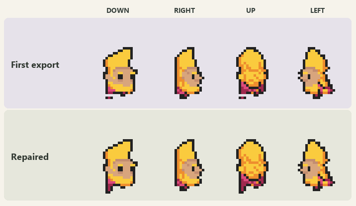

# Character walk trial, 24 November 2026

Six fresh-context agents received a gameplay brief, neutral filenames, a working directory and the path to a locally installed Pixelbolt package. Each had access to public documentation and general-purpose tools. The scorer and the other participants' files were outside the assigned workspace. Isolation was by instruction. The agents could run checks, draw pixels and revise their own work. Each kept its first export.

| Run | First export | Revisions and final observation |
| --- | --- | --- |
| Imp, baseline | One malformed import put the character name in the cut manifest. The first successful export kept every supplied standing pixel and both boots attached through eight steps. | The first export became the final art. Headless Godot played the 100 ms steps. The small rigid body gives the imp a stiff waddle. |
| Porter, baseline | The guide led to four faithful stands. Across 32 walk frames, the native review found 20 frames with newly detached islands and eight with clipping. Independent inspection confirmed whole boots separated. | The agent expanded the cycle, drew hidden boot shafts, changed the stacking order and keyed the walks. Its final preserved the four stands and satchel with zero weak joints. The upward walk retained a 1.5 px slide advisory at the assumed movement speed. |
| Scout, baseline | Starting from one front view, the agent drew a rear headband knot and a profile. The bottom edge cropped eight front/back walk frames and some tunic pixels travelled with a profile foot. | The agent isolated the arms, retouched the moving boots and adjusted their trajectories. The original front was exact, the eyes and headband read differently from the rear, and four real arrow-key walks and stops passed in Godot. |
| Porter, independent repeat | The same brief and inputs on the first improved build produced four exact stands, zero separated or clipped frames and zero weak joints on the first export. The agent found the new option in the public guide. Pink and yellow coat colours showed on the extended shafts and the long side strides had 1 px of slide. | The agent recoloured two hidden rows per boot and reduced side stride. All four walks then had zero measured slide at the chosen 10 px/s. This colour finding led to the shipping implementation, which extends the boot's top colour beneath the original hem. |
| Lamplighter, first transfer | From one new front view, the agent drew a back and two profiles. The original palette, standing pixels, off-centre pivot, and lantern visibility passed on the first export. In left-facing frame 5 a foot carried three lantern-rim pixels. | The agent narrowed the foot selection and adjusted the stance. The rim stayed together in the revised walk. Godot played four 960 ms loops with responsive arrow keys and last-facing stops. The profiles still read as a shuffle in part of the stride. |
| Watchmaker, second transfer | After the colour fix, a fresh agent received a new robot with two pieces of asymmetric equipment. It authored its own editable parts and used native `walkCycles`. Its first export had no clipped, separated or weak joints, preserved the two front lights, and correctly hid the lantern and plate on opposite profiles. The lantern overlapped the boot in left-facing frame 5. | In the revised left profile the lamp sits farther out and its cage reads separately from the foot. All four 120 ms walks, arrow movements, facing-specific stops and the ground pivot passed in the submitted Godot project. This run exercised the full authoring workflow. The controlled porter replay directly tests the importer change. |

The baseline used the package built from merge `a036266`. SHA-256 of the installed tarballs was `a1fa8c07256c84dc9865f3e7bd9e4ef0c263c5982d82b2af810dd3fe69a210b4` for the baseline, `b861c404b26c0907b3c75036c29940d0782e5de081a874260b72ca5c368a661e` for the first improvement and `b2ba6a2513083dbd7b4e543f40fac9a05437d95064b3fc25604023781acc167a` for the final build. All three local packages carried version 0.20.0.

## Replaying the original failure

Start from the [first porter's actual cuts](porter-first.cuts.json). Remove its zero margin and set `extendFeet: 2` on the four facings. This removes the 20 separated and eight clipped frames while preserving the four supplied stands at their ground points. The same import through the CLI and MCP produced byte-identical editable poses, sheets, atlases and SpriteFrames, and matching reviews. This controlled replay holds the art and the selections fixed. The independent repeat above tests what a new agent can discover.

These are developer-run observations with one participant per brief/build combination. The graders verify measurable pixels and runtime behavior. The lantern-rim error shows why they also need a visual review of the selected parts through their entire stride.
