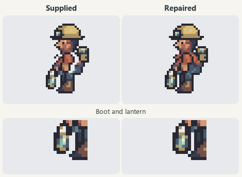

# Pixelbolt lamp crossings

The station porter and quarry surveyor are original indexed pixel drawings authored for this evaluation. The layered sprites, palettes and benchmark code are in this folder. Neither drawing uses third-party assets.

Run from this directory with Python 3.10 or newer, Pillow 10 or newer, and a compatible Pixelbolt public CLI. The initial references were rendered with Pixelbolt 0.20.0. Replace `pixelbolt` with the path to the command on the test machine as needed.

```sh
python build.py --cli pixelbolt
python verify.py --cli pixelbolt
```

The first command creates both participant handoffs and the private control and starter references. The second verifies all four and exercises two additional mutations. The station mutation extends two lantern pixels beneath the foreground boot. The altered walk reveals six extra pixels across the cycle and passes. The quarry mutation swaps the boot and lamp depth. It preserves standing owners and fails 23 moving coverage probes, including 17 that look identical in RGBA.

## Run a participant

Copy each file in the selected `cases.json` entry’s `participantFiles` into a fresh directory using its basename. Give the participant the entry’s `brief`. To run the clean control, stage the same filenames and apply the listed substitutions. Keep the private files, generator and oracle outside the participant’s workspace.

The quarry starter pose records the intended placement of the far hand behind the near boot. Re-importing its cuts alone recreates Pixelbolt’s default depth. The same explicit order is supplied for both quarry variants.

## Trial results

[Read the fresh-agent runs and limitations](results.md) or inspect the eight steps below.



## Score a delivery

```sh
python oracle.py --case station --source delivery/sprite.poses.json --export delivery/export --cli pixelbolt
```

Choose `quarry` for the second case. Supply `--gif delivery/walk.gif` when the walk GIF is separate from the native export. The score includes rest-image agreement, visible rest ownership, motion of original boot and lamp material, foreground crossings, visible rim carry, timing, anchors, and frame agreement across the source, PNGs, atlas sheet and looping GIF. The process returns 0 for a pass and 1 for a material failure. A malformed or incomplete delivery can produce an input error.

The fixture retains the original frame coordinate system in `private/truth.json`. Visible material masks are taken from the authored layers before the starter cuts exist. Painted masks also record concealed ink. The oracle projects those material pixels using the artist’s eight-frame exposure sheet and assigns candidate layers to carriers using their measured displacements. This permits renamed parts and hidden underpaint. The scorer assumes native opaque cutout parts and stable pose instance names throughout each clip. A fresh authored rig with independently rotating bones or changing instance identities requires separate adjudication.

Offline reference checks require only Python, Pillow and the generated reference files.

```sh
python oracle.py --case quarry --reference control
python oracle.py --case quarry --reference starter
```

The starter command returns 1 because it contains the intentional transfer. Each private reference directory contains its editable pose, compiled recipe, pose metadata and public production export. Source credits and private art-direction expectations are also recorded in `cases.json`.
