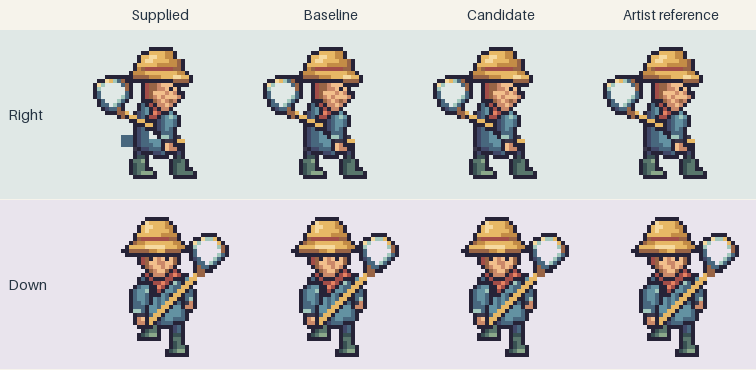
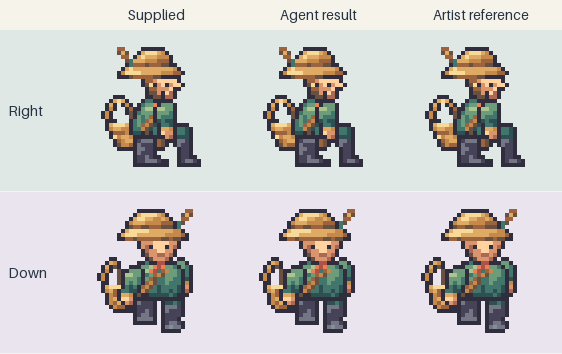
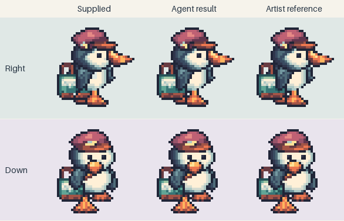

# Six blind whole-walk reviews

Six fresh agents each received a character, its two standing drawings and a production brief. **All three clean sources were retained byte for byte. All three damaged walks were repaired**, including the surveyor’s shaft and coat gap and Tilda’s satchel and wing seam. Every submitted source retained the original standing RGBA, ground anchors, gait, timing and visible ownership. The six submissions also passed independent checks of their first native renders, final atlas, frame PNGs and looping GIFs.

The automatic scan found the surveyor’s exposed shaft in **3/3** affected phases, its coat gap in **6/6**, and Tilda’s wing gap in **3/3**. It reported **no equipment-transfer finding** on either held-out character. Both agents used isolated part views and a follow-up ownership track to finish the repair. This trial demonstrates the combined workflow. An agent that only consumed the automatic findings would have missed those transfers.

## First locked trial

A witness sample is one artist-selected native pixel in one phase. The counts below are failed defect samples before and after each independent review. Passing also requires every opening, crossing, delivery and preservation check. RGBA differences count all pixels in all frames against the private artist drawing. [Detailed scores](results.json) · [Native-coordinate localization](localization.json)

| Session | Character and input | Failed samples, first → final | Final RGBA differences | Final |
| --- | --- | --- | ---: | --- |
| Baseline · quartz | Salt-marsh surveyor, damaged | Shaft 16 → 0, joint 23 → 0 | 6 | Pass |
| Candidate · sable | Salt-marsh surveyor, clean | 0 → 0 | 0 | Pass |
| Candidate · flint | Salt-marsh surveyor, damaged | Shaft 16 → 0, joint 23 → 0 | 6 | Pass |
| Candidate · amber | Marn, clean | 0 → 0 | 0 | Pass |
| Candidate · linden | Marn, damaged | Equipment 35 → 0 | 0 | Pass |
| Candidate · opal | Tilda, clean | 0 → 0 | 0 | Pass |
| Candidate · birch | Tilda, damaged | Joint 9 → 0, equipment 92 → 0 | 0 | Pass |

Both surveyor repairs used a nearby shade on six newly uncovered coat pixels. Every one is opaque, lies inside the artist’s damaged joint region and follows the correct surface. There were zero pixel changes outside those regions relative to the clean drawing and zero ownership differences. The installed baseline agent also solved the surveyor. A single baseline run on the development character gives no estimate of a repair-rate improvement.

At every protected crossing the scorer checked the visible carrier and the painted part behind it. Each surveyor submission passed 392 opening and 95 crossing samples. Marn passed 32 and 16, and Tilda passed 32 and 27. All seven submitted bundles contained 18 native frames and two verified walk GIFs. An independent replay of the editable submissions reproduces the pixel scores. [Reproduction instructions](README.md) · [Agent notes and editable submissions](submissions/)

## Character comparisons

The columns follow the same playback clock so each repaired phase can be compared with the supplied artwork and the artist drawing.

The [revised production sprite](../../showcase/tide-post/) shows Tilda with a centered front-facing bill and matching webbed feet. The comparison above records the artwork used in the blind trial.

## What remains difficult

On the clean inputs the scanner listed three candidate opening groups for the surveyor, two for Marn and five for Tilda. They included spaces formed between limbs during a step. All three reviewers checked those cues and preserved the artwork. The public moving-edge tests also detect transferred outlines in the earlier station and quarry sprites, but those examples did not predict detection of the new basket and satchel fragments. Candidate equipment witnesses had a matching automatic transfer coordinate in 0/8 affected phases for each held-out sprite. An opening on the creel/boot boundary did help Marn’s reviewer find the relevant layers.

## Trial record

- The baseline was installed from `22403d505d43fb9fa461e2813eefc0a064e08164`. The candidate was installed once from `a14b900cbe8978e13e01a8c82b2fd5a51bcee56f`. Their package hashes are recorded in the score file. Each agent used an installed CLI. The MCP entry point was tested for report and contact-sheet parity.
- The surveyor was the development case. Two independent artists froze Marn and Tilda before development-case tuning. Their generators, artist drawings, controls and witnesses stayed outside the development and participant inputs. The first locked package was used for all six candidate submissions.
- Each participant started with a fresh conversation and one neutral job directory. The task wording was identical apart from local paths. The two variants shared a brief and standing references. Participants were instructed to stay inside their job and use the public tool. Isolation was instruction-based. The baseline install path contained the word `baseline`. Candidate install paths contained no condition labels. No participant received grader feedback or a second attempt.
- The scorer was locked after inspecting the baseline and before scoring candidate submissions. The allowance for alternate underpaint uses a radius of three native pixels on the correct material and owner. The report retains exact RGBA counts alongside the scored result. The scorer passed its clean self-checks, rejected every artist-damaged input and rejected three disabled-motion mutations. [Scoring criteria and hashes](SCORER-LOCK.json)
